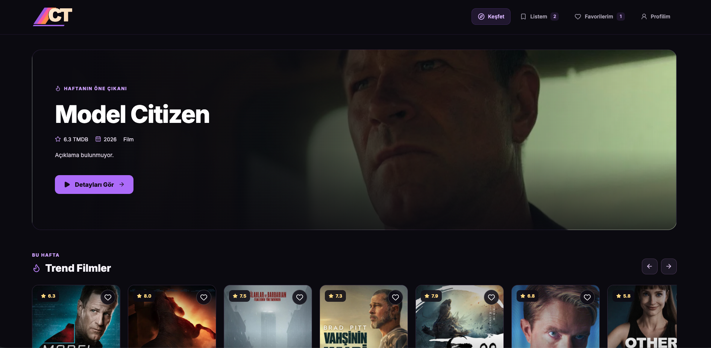
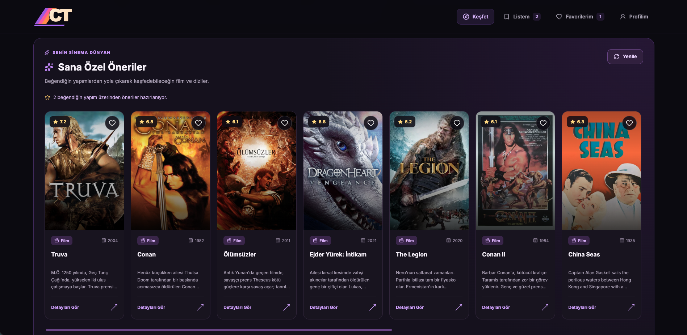
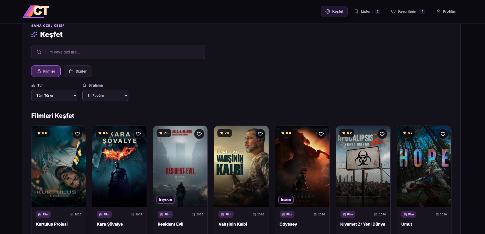
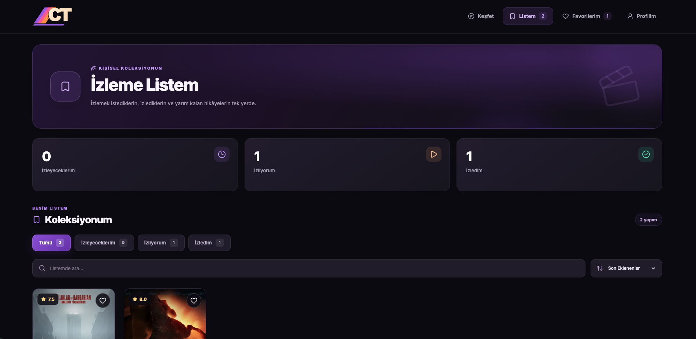
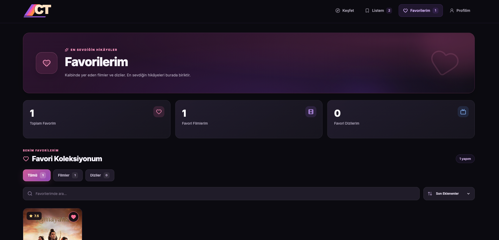
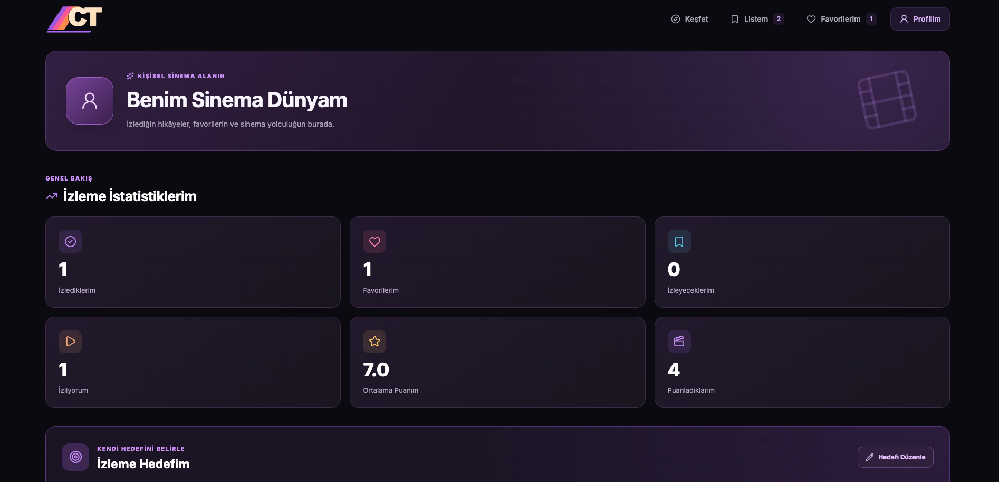
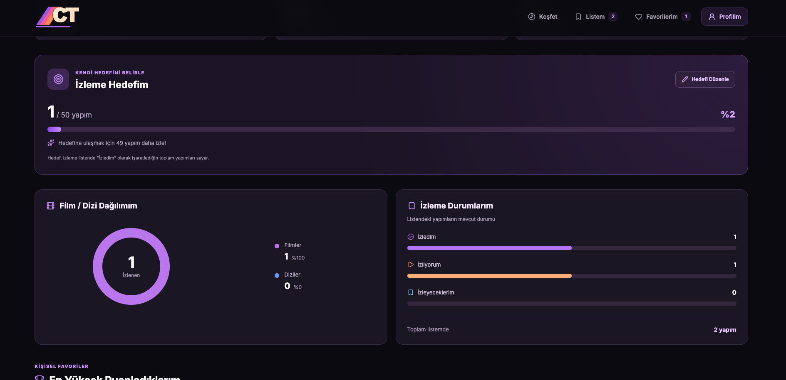

# 🎬 CineTrack

### Discover. Watch. Track.

CineTrack, kullanıcıların film ve dizileri keşfedebildiği, kişisel izleme listeleri oluşturabildiği, favori içeriklerini kaydedebildiği ve izleme alışkanlıklarını takip edebildiği modern bir web uygulamasıdır.

React ve Vite kullanılarak geliştirilmiş olup film ve dizi verilerini The Movie Database (TMDB) API üzerinden dinamik olarak almaktadır.

## 🌐 Canlı Demo

**[CineTrack'i Keşfet](https://thriving-swan-10c781.netlify.app/)**

## ✨ Özellikler

- **Film ve Dizi Keşfi:** TMDB API üzerinden güncel içerikler
- **Trend İçerikler:** Popüler ve öne çıkan film/diziler
- **Gelişmiş Arama:** Film ve dizileri arama
- **Filtreleme ve Sıralama:** Tür ve farklı kriterlere göre içerik keşfi
- **Detaylı İçerik Sayfaları:** Açıklama, puan, oyuncular ve fragmanlar
- **İzleme Listem:** İzlenecek içerikleri kaydetme ve yönetme
- **İzleme Durumu Takibi:** İzleyeceğim, izliyorum ve izledim durumları
- **Favorilerim:** Beğenilen içerikleri kişisel koleksiyonda saklama
- **Kişisel Puanlama:** Film ve dizileri yıldızlarla değerlendirme
- **Öneriler:** Kullanıcı tercihlerine yönelik içerik önerileri
- **Profil ve İstatistikler:** İzleme hedefleri, grafikler ve kişisel özetler
- **Responsive Tasarım:** Masaüstü, tablet ve mobil cihazlarla uyumlu arayüz
- **Kalıcı Veri Saklama:** LocalStorage ile kişisel verilerin tarayıcıda saklanması

## 🛠️ Kullanılan Teknolojiler

| Teknoloji | Kullanım |
|---|---|
| React | Kullanıcı arayüzü ve bileşen mimarisi |
| JavaScript (ES6+) | Uygulama mantığı |
| Vite | Geliştirme ortamı ve production build |
| CSS3 | Responsive tasarım ve animasyonlar |
| TMDB API | Film ve dizi verileri |
| LocalStorage | Kullanıcı listeleri, favoriler ve puanlar |
| Lucide React | Arayüz ikonları |
| Git & GitHub | Versiyon kontrolü |
| Netlify | Canlı yayınlama |

## 📸 Ekran Görüntüleri

### Ana Sayfa


### Kişiselleştirilmiş Öneriler


### Film ve Dizi Keşfi


### İzleme Listem


### Favorilerim


### Profilim


### İzleme İstatistikleri


## 🚀 Kurulum

Projeyi bilgisayarınızda çalıştırmak için:

### 1. Repository'yi klonlayın

```bash
git clone https://github.com/ebrucihan/CineTrack.git
```

### 2. Proje klasörüne girin

```bash
cd CineTrack
```

### 3. Bağımlılıkları yükleyin

```bash
npm install
```

### 4. Ortam değişkenlerini oluşturun

Proje ana dizininde `.env.local` dosyası oluşturun:

```env
VITE_TMDB_API_KEY=YOUR_TMDB_API_KEY
```

API anahtarınızı [TMDB](https://www.themoviedb.org/) üzerinden edinebilirsiniz.

### 5. Geliştirme sunucusunu başlatın

```bash
npm run dev
```

Terminalde gösterilen yerel adresi tarayıcınızda açın.

### 6. Production build oluşturun

```bash
npm run build
```

## 🤖 Yapay Zekâ Destekli Geliştirme

Bu proje, yapay zekâ destekli web geliştirme yaklaşımıyla hazırlanmıştır.

Geliştirme sürecinde **ChatGPT (OpenAI)** yazılım geliştirme asistanı olarak kullanılmıştır.

Yapay zekâ desteğinden şu aşamalarda yararlanılmıştır:

- Proje fikrinin ve uygulama kapsamının planlanması
- React bileşen mimarisinin oluşturulması
- Kullanıcı arayüzü ve CSS tasarımının geliştirilmesi
- TMDB API entegrasyonunun yapılandırılması
- LocalStorage tabanlı veri yönetimi
- Responsive tasarım iyileştirmeleri
- Hata ayıklama ve kod düzenlemeleri
- GitHub ve Netlify yayınlama süreçlerinde teknik rehberlik

Proje geliştirme sürecinde yapay zekâ çıktıları değerlendirilmiş, uygulama üzerinde test edilerek düzenlenmiştir.

## 💾 Veri Saklama

CineTrack, kullanıcı verilerini tarayıcının **LocalStorage** alanında saklar.

Favoriler, izleme listeleri, izleme durumları ve kişisel puanlamalar sayfa yenilendiğinde korunur.

Uygulamada kullanıcı hesabı veya bulut tabanlı veri senkronizasyonu bulunmamaktadır. Veriler kullanılan tarayıcıya ve cihaza özeldir.

## 📱 Tasarım

CineTrack, sinema platformlarından ilham alan koyu temalı bir kullanıcı arayüzüne sahiptir.

Mor tonları, sinematik arka planlar, kart tasarımları ve mobil cihazlara özel navigasyon ile kullanıcı deneyimi ön planda tutulmuştur.

## 📚 Proje Hakkında

Bu proje, **Yapay Zekâ Destekli Web Geliştirme** eğitimi kapsamında hazırlanmıştır.

Amaç; React, JavaScript, API entegrasyonu, bileşen tabanlı geliştirme, veri yönetimi ve responsive tasarım konularındaki bilgileri gerçek bir uygulamada bir araya getirmektir.

## 👩‍💻 Geliştirici

**Ebru Cihan**

GitHub: [github.com/ebrucihan](https://github.com/ebrucihan)

---

⭐ CineTrack — Your personal movie & TV companion.

*This product uses the TMDB API but is not endorsed or certified by TMDB.*
